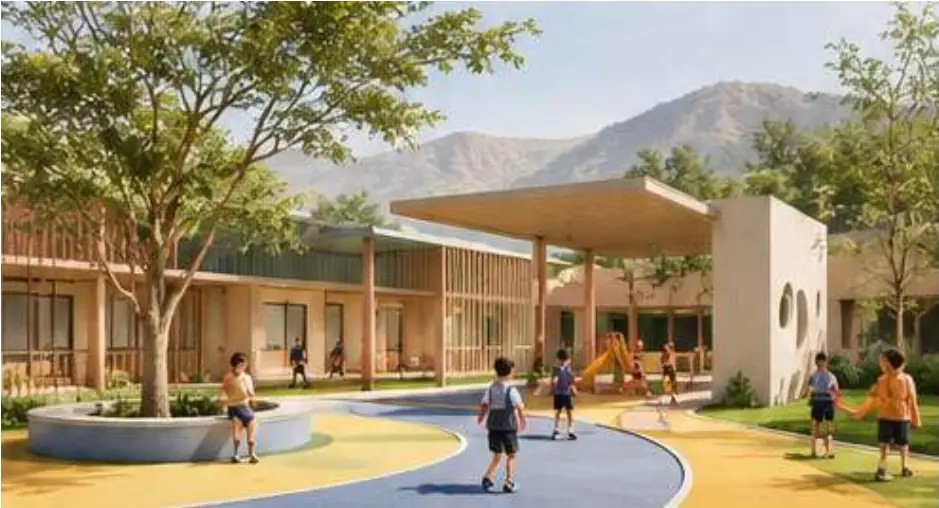
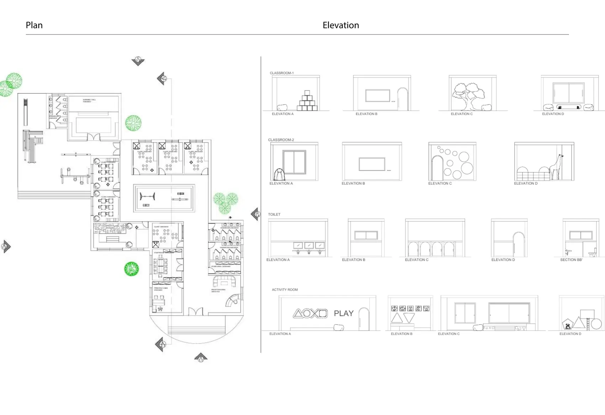
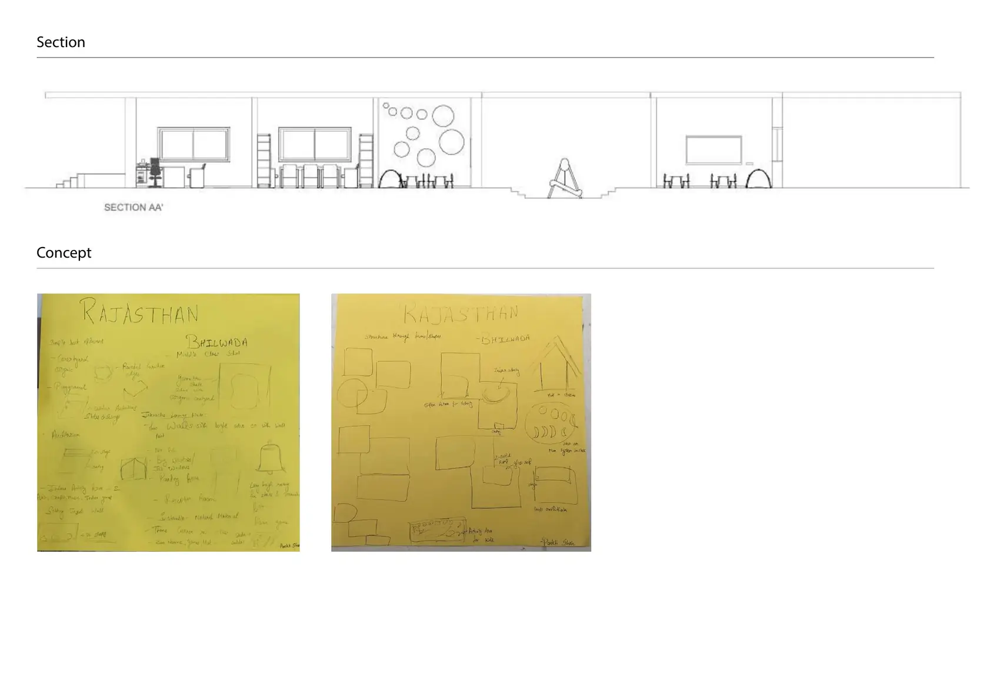
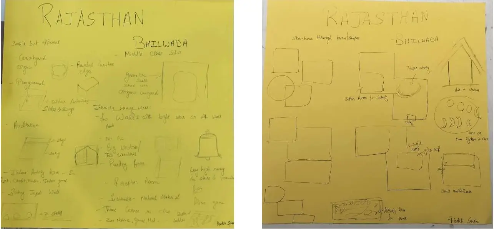

# Block and Flow: Pre-school to Grade 1

*Learn, play, grow*

Courtyard view of the school and play areas

| | |
|---|---|
| **Semester / context** | Semester 5 |
| **Type** | Pre-school to Grade 1 |
| **Location** | Bhilwara, Rajasthan |
| **Users** | Pre-primary to Grade 1 students, teachers, staff |
| **Case studies** | Rajkumari Ratnavati Girls’ School, MCD Pratibha Vidyalaya, Panyaden International School, Toy Story Play School |
| **Focus** | Child-centred design, learning spaces, play and interaction, climate-responsive design, safety |
| **Key spaces** | Classrooms, activity spaces, play areas, multipurpose space, administration, washrooms |

## Design brief

A safe, engaging school for pre-primary to Grade 1 children, their teachers and staff, with age-appropriate learning spaces, play areas and room to interact. The design responds to Bhilwara’s hot, dry climate.

## Concept

Block and Flow combines playful building blocks with organic movement. Simple geometric blocks hold the classrooms, while softer, flowing forms carry circulation and play, so the school feels connected, safe and full of discovery for young children.

## Drawings and views

### Ground plan with classroom, toilet and activity room elevations

### Section AA’ and early concept sketches

### Concept sketches for the Bhilwara site

---

Designed by **Pankti Shah**, Bachelor of Design (Interior Design), Indus Design School, Indus University, Ahmedabad.

Full portfolio: [pankti1305.github.io](https://pankti1305.github.io)  
Contact: [pankti1305@gmail.com](mailto:pankti1305@gmail.com)
